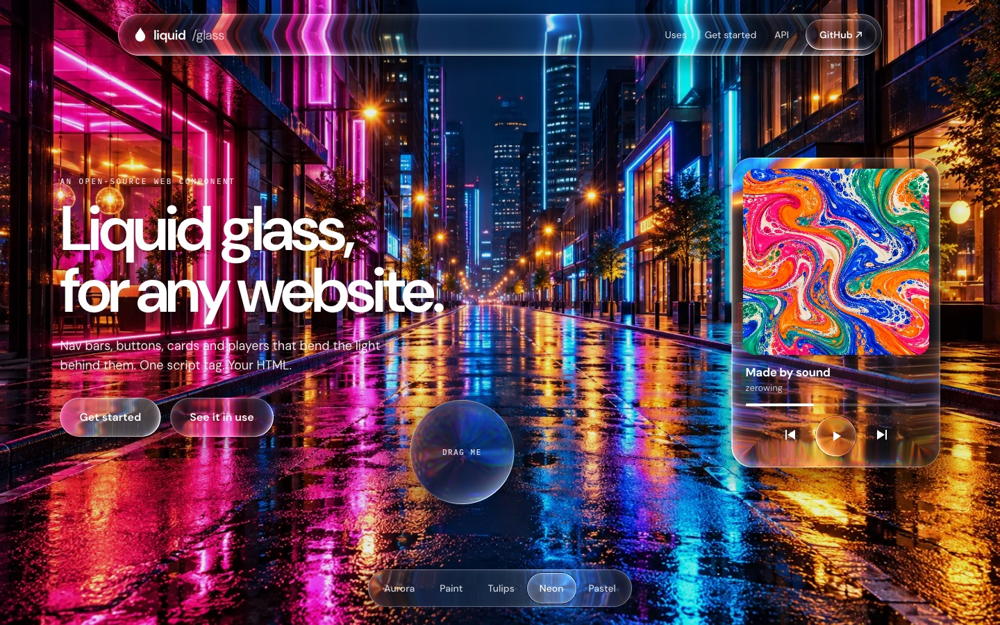
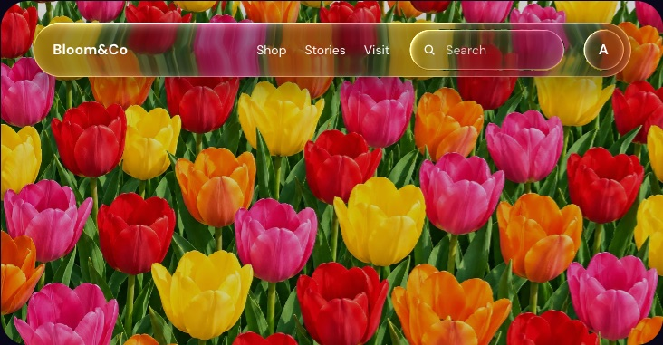
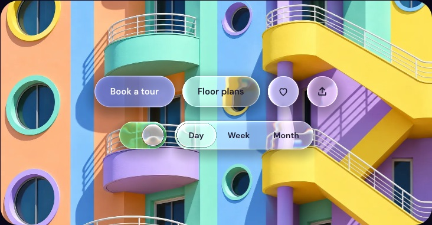
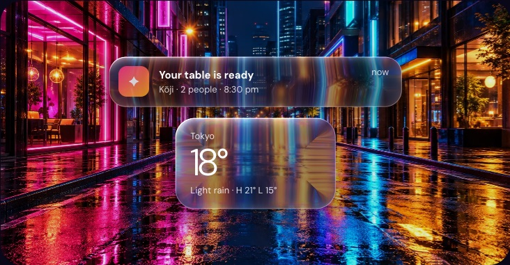
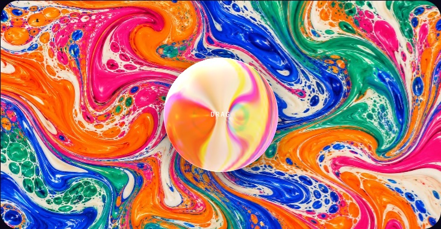

# liquid / glass

**Liquid glass for any website.** A drop-in web component that turns your nav bars, buttons, cards and players into curved glass that bends the light behind it. One script tag, your own HTML and CSS, no dependencies.

**[Live demo → zerowing.in/glass](https://zerowing.in/glass/)**



## Use it

```html
<script type="module" src="https://cdn.jsdelivr.net/gh/MuhammadaliMS/liquid-glass@1/dist/liquid-glass.js"></script>

<liquid-glass backdrop="hero.jpg" dim=".25" style="height: 100vh">
  <nav glass class="navbar">…</nav>
  <h1>Your headline</h1>
  <a glass href="/signup" class="button">Get started</a>
</liquid-glass>
```

1. Wrap a section in `<liquid-glass>` and give it a `backdrop`: the built-in animated `aurora`, an image or a video.
2. Add `glass` to anything inside that should be glass.
3. Style those elements as usual: padding, size and `border-radius`. Leave their background transparent.

The glass follows each element's real size, position and border-radius every frame, so CSS transitions, hover states and responsive layouts just work.

| | |
|---|---|
|  |  |
|  |  |

## Where it goes

- **Navigation:** floating nav bars, search fields, avatars.
- **Buttons and controls:** primary and secondary buttons, icon buttons, switches, segmented controls. They swell when pressed.
- **Cards:** notifications, toasts, widgets, modals and media players over photos or video.
- **Tab bars and toolbars:** the app-style bar at the bottom of a mobile site.
- **Lenses:** add `glass-drag` and visitors can drag it around; it stretches as it moves.

## API

### `<liquid-glass>`

| Attribute | Values | |
|---|---|---|
| `backdrop` | `aurora` (default), or an image or video URL | What the glass refracts. Images and videos on another domain need CORS headers. |
| `dim` | `0` to `0.9` | Darkens the backdrop so text over it stays readable, like a scrim on a hero photo. |
| `colors` | up to four CSS colours | The aurora's colours, e.g. `"#ff5a1f #ff2d8a #6a3bff #00c2ff"`. |
| `reduce-motion` | boolean | Holds everything still. Also follows the visitor's system setting. |

### Glass elements (any descendant)

| Attribute | |
|---|---|
| `glass` | Render this element as glass. Up to 16 per scene; later elements sit on top of earlier ones, so a knob can sit on its track. |
| `glass-drag` | Let the visitor drag it. |

| CSS custom property | Default | |
|---|---|---|
| `--glass-tint` | `rgba(255,255,255,.04)` | A colour mixed into the glass; alpha is the strength. `rgba(40,110,255,.55)` makes a blue button. |
| `--glass-frost` | `0.08` | 0 is clear, 1 is fully frosted. Raise it over busy backdrops so text stays readable. |
| `--glass-bend` | a third of the short side | How strongly the rim bends the backdrop, in px. Turn it up for a magnifier. |
| `--glass-rim` | about 40% of the short side | How wide the curved rim is, in px. |
| `--glass-press` | `1.045` | How much it grows when pressed; `1` turns it off. |
| `--glass-shadow` | `1` | Drop shadow strength, 0 to 1. |
| `--glass-chroma` | `0.06` | Colour fringing at the rim. |

### JavaScript

```js
const scene = document.querySelector('liquid-glass');
scene.backdrop = '/winter.jpg'; // swap the backdrop
scene.panes;                    // the glass elements being rendered
```

## Frameworks

It's a standard custom element, so it works the same in React, Vue, Svelte, Astro and plain HTML.

```bash
npm install github:MuhammadaliMS/liquid-glass
```

```jsx
import '@zerowing/liquid-glass';

export function Hero() {
  return (
    <liquid-glass backdrop="/hero.jpg" style={{ height: '80vh' }}>
      <button glass="" className="cta">Get started</button>
    </liquid-glass>
  );
}
```

## Good to know

- **The glass bends its scene's backdrop, not the page.** Browsers don't let WebGL read the rest of the page, so each `<liquid-glass>` draws its own backdrop and the glass refracts that. Use it for heroes, headers and sections with a strong image, video or the aurora.
- **Your content stays real HTML.** Text, links, inputs and buttons inside glass elements are ordinary DOM: accessible, selectable and clickable. Only the glass is drawn.
- **It's light.** About 10 KB gzipped. One WebGL canvas per scene, idle when nothing moves, paused off-screen and in background tabs.
- **It degrades gracefully.** Without WebGL, glass elements fall back to frosted CSS (`backdrop-filter`).

## Develop

```bash
npm install
npm run dev     # the demo page with live reload, at http://127.0.0.1:5250
npm test
npm run build   # dist/liquid-glass.js and types
```

## License

MIT © [zerowing](https://zerowing.in)
